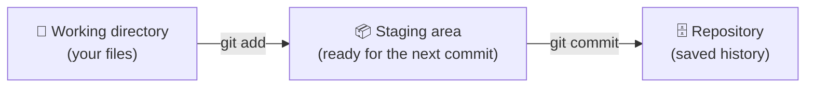
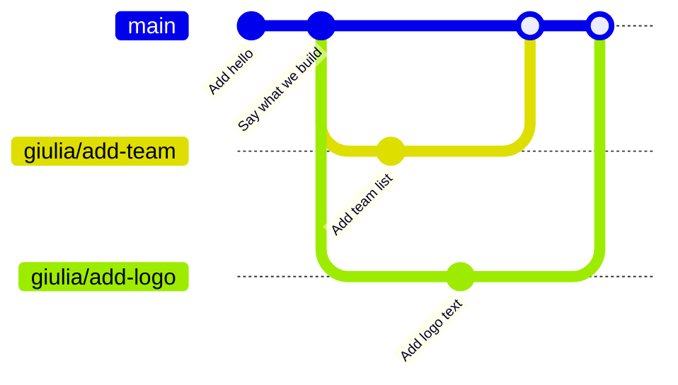

# 01 · Git basics

## What is git?

Git is a **version control system**. It saves snapshots of your project over
time, so you can:

- see **what** changed, **when**, and **who** changed it
- go back to an earlier version
- work on several things at once, alone or with others, without them mixing up

Git runs **on your computer**. **GitHub** is a website that stores git
repositories online so a team can share them. They are two different things.

## The three areas

Every change you make goes through three steps:



1. **Working directory:** the files you see and edit.
2. **Staging area:** the changes you've *chosen* for the next snapshot.
3. **Repository:** the saved history of snapshots (stored in the hidden `.git/` folder).

## A commit

A **commit** is one saved snapshot. It has:

- a unique ID (like `a1b2c3d`)
- an author and a date
- a **message** saying what changed

Commits form a chain, and that chain is your project's history.

## Try it: your first commits

Do this in a practice folder (**not** inside the workshop repo):

```bash
mkdir git-playground
cd git-playground
git init                  # start tracking this folder with git
git status                # what's going on? Use this ALL the time
```

Create a file, stage it, and commit it:

```bash
echo "Hello H2politO" > hello.txt
git status                # hello.txt is "untracked"
git add hello.txt         # stage it
git status                # now it's "to be committed"
git commit -m "Add hello.txt"
```

Change it, look at the change, and commit again:

```bash
echo "We build hydrogen cars" >> hello.txt
git diff                  # shows what changed
git add hello.txt
git commit -m "Say what we build"
```

Look at the history:

```bash
git log --oneline         # one line per commit
```

```
b7c1e2f Say what we build
a1b2c3d Add hello.txt
```

## Branches: one per feature 🌿

This is the most important idea of the workshop.

A **branch** is a separate line of work. When you work on a branch, your
commits stay **on that branch only**. `main` and every other branch are untouched.

**Rule:** every feature or fix gets **its own branch**. Fixing a bug and
adding a new function are two things, so they need two branches.

Why?

- each feature can be reviewed and merged **on its own**
- if one feature turns out badly, you throw away its branch and the other is unaffected
- you can switch between features at any time without mixing them up



### Try it: two features, two branches

Still in `git-playground`:

```bash
# Feature 1: a team list
git switch -c giulia/add-team      # create a branch AND move onto it
echo "- Giulia" > team.txt
git add team.txt
git commit -m "Add team list"

# Back to main: team.txt is GONE (it only exists on the other branch)
git switch main
ls

# Feature 2: something completely different, on its own branch
git switch -c giulia/add-logo
echo "H2politO 🚗" > logo.txt
git add logo.txt
git commit -m "Add logo text"
ls                                 # logo.txt is here, team.txt is not
```

Switch back and forth and run `ls` each time. Each branch only has its own work:

```bash
git switch giulia/add-team && ls
git switch giulia/add-logo && ls
git branch                         # list your branches (* is where you are)
git log --oneline --graph --all    # see all branches as a drawing
```

When a feature is finished, it is **merged** into `main`. On GitHub this happens
through a pull request (see [03](03-github-workflow.md)), but you can try it locally:

```bash
git switch main
git merge giulia/add-team
git merge giulia/add-logo          # an editor may open for a merge message: just save and close
ls                                 # now main has both files
```

> ⚠️ **Before switching branches, commit your work** (or git may refuse to
> switch). `git status` tells you if you have unsaved changes.

> 💡 Older tutorials use `git checkout` instead of `git switch`. It works too.

## Remotes: talking to GitHub

A **remote** is a copy of your repository on GitHub.

| Command | What it does |
|---------|--------------|
| `git clone <url>` | Download a repository from GitHub |
| `git pull` | Get new commits from GitHub into your current branch |
| `git push` | Upload your commits to GitHub |
| `git remote -v` | Show which remotes you have |

## .gitignore

Some files should never be committed: virtual environments, caches, editor
settings, and **passwords**. You list them in a file called `.gitignore`.

👉 Read the **[.gitignore guide](gitignore-guide.md)**. It covers VS Code,
PyCharm, your OS, and what to do if you committed something by mistake.

## Undoing things

| I want to… | Command |
|------------|---------|
| Throw away my changes to a file | `git restore <file>` |
| Unstage a file (keep the changes) | `git restore --staged <file>` |
| Fix the message of my last commit (before pushing) | `git commit --amend -m "Better message"` |
| Undo a commit that is already on `main` | `git revert <commit-id>`, on a new branch |

> 🔐 **Never commit passwords or keys.** Even if you delete them later, they stay
> in the history.

## Good commit messages

Start with a verb and say what changed: `Fix lap time formatting`,
`Add slowest_lap function`. A good message completes the sentence
*"If applied, this commit will…"*

Next: **[02 · Trunk-based development →](02-trunk-based-development.md)**
