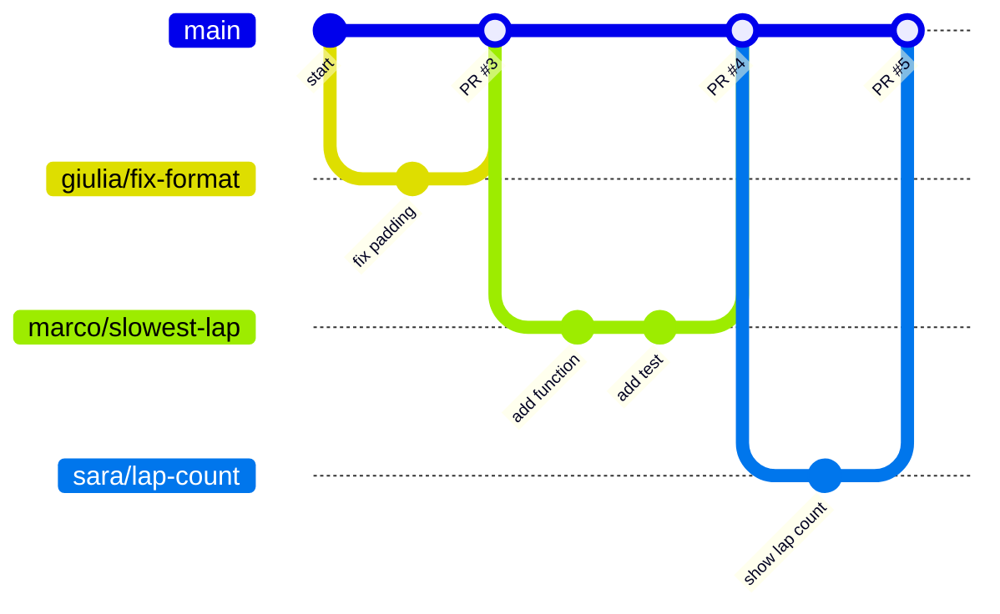

# 02 · Trunk-based development (how we work)

## The problem

Ten people work on the same code. Each one works alone on a branch for three
weeks, then everyone tries to merge the week before the competition. The result
is **merge hell**: huge conflicts, broken code, and nobody knows which version works.

## The idea

Everyone integrates their work into **one shared branch**, the **trunk** (for
us, `main`), **little and often**.



Each branch is for **one feature**, lives for **hours or a day or two**, then
it's merged into `main` and deleted.

## Our rules

| Rule | Why |
|------|-----|
| **`main` always works** | Anyone can take `main` and run it on the car at any moment |
| **Nobody pushes directly to `main`** | Every change is reviewed and tested first. GitHub *enforces* this ("branch protection") |
| **One branch per feature or fix** | Each change is reviewed, merged, or thrown away on its own |
| **Short-lived branches** | The longer a branch lives, the further it drifts from `main`, and the worse the conflicts |
| **Small pull requests** | A 30-line PR gets a real review in 5 minutes. A 2000-line PR gets "looks good 👍" and nobody reads it |
| **Automatic tests on every PR** | GitHub runs the tests, so broken code can't be merged |
| **Pull `main` often** | You find conflicts early, while they are still small |

## Keeping your branch up to date

While you work on your branch, other people merge into `main`. To bring their
changes into your branch:

```bash
git pull upstream main      # (you'll set up "upstream" in the exercises)
git push
```

If git says there's a **conflict**, you and someone else changed the same
lines. You'll practise fixing that in [Exercise 5](04-exercises.md#exercise-5--fix-a-merge-conflict).

## Going further (not needed today)

- **Feature flags:** a big feature that takes weeks is merged in small pieces,
  hidden behind an on/off switch, so `main` keeps working.
- **Rebase:** an alternative to `git pull` that keeps your branch's history
  tidier. Learn it once you're comfortable with branches.
- **GitFlow:** a different, heavier style with `develop` and `release`
  branches. You may meet it in other companies.

Next: **[03 · GitHub workflow →](03-github-workflow.md)**
