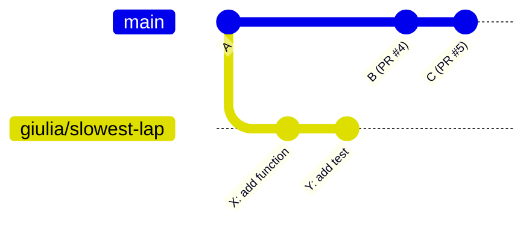
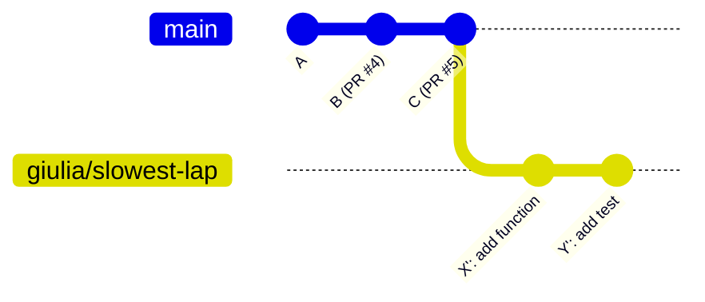

# Rebase guide

While you work on your branch, teammates merge their work into `main`. Your
branch is now **behind**. There are two ways to catch up:

- **merge** (`git pull upstream main`): what you did in Exercise 5
- **rebase** (`git rebase upstream/main`): this guide

Both are fine. Rebase is the one you'll see most often in teams that do
trunk-based development, because it keeps history **straight and easy to read**.

---

## 1 · What rebase does

You started your branch a while ago. Since then, two PRs were merged into `main`:



`git rebase upstream/main` **picks up your commits and replays them on top of
the latest `main`**, as if you had started your branch just now:



Notice the `'` in `X'` and `Y'`: they are **new commits** with the same changes
but **new IDs**. Rebase *rewrites* your branch's history. That's why you need a
special push afterwards (section 3).

### Merge vs. rebase

| | `git pull upstream main` (merge) | `git rebase upstream/main` |
|---|---|---|
| What happens | adds a "merge commit" joining main into your branch | moves your commits on top of main |
| History | has extra merge commits and side lines | one straight line |
| Commit IDs | unchanged | **your** commits get new IDs |
| Push afterwards | normal `git push` | `git push --force-with-lease` |
| Conflicts | fixed once, then `git commit` | fixed per commit, then `git rebase --continue` |
| Good for | beginners, branches that others also work on | your **own** branch, before and during review |

---

## 2 · The golden rule ⚠️

> **Only rebase your own branch. Never rebase `main`, and never rebase a branch
> someone else is working on.**

Rebase gives commits new IDs. If a teammate already has the old ones, their
history and yours no longer match and things get messy. Your own feature branch
is yours, so rebase it as much as you like. (`main` is protected anyway, so
GitHub won't let you force-push it.)

---

## 3 · Step by step

```bash
git switch yourname/my-feature   # 1. go to YOUR branch
git status                       #    must say "nothing to commit". Commit or stash first
git fetch upstream               # 2. download the latest main (doesn't change your files)
git rebase upstream/main         # 3. replay your commits on top of it
git log --oneline --graph -5     # 4. check: your commits are now on top
git push --force-with-lease      # 5. update your branch on GitHub (and your PR)
```

### Why "force"?

After the rebase, your branch on GitHub still has the **old** commits (`X`, `Y`)
and your laptop has the **new** ones (`X'`, `Y'`). A normal `git push` is refused:

```
 ! [rejected]        yourname/my-feature -> yourname/my-feature (non-fast-forward)
hint: Updates were rejected because the tip of your current branch is behind
```

That's expected after a rebase. You *want* to replace the old commits, so you force the push.

### Why `--force-with-lease` and not `--force`?

- `--force` overwrites the remote branch **no matter what**.
- `--force-with-lease` overwrites it **only if nobody else pushed to it since you
  last looked**. If someone did, it refuses instead of silently destroying their work.

**Always use `--force-with-lease`.** Make it a habit, even if you're sure.

---

## 4 · Conflicts during a rebase

If your commit and `main` changed the same lines, the rebase stops:

```
CONFLICT (content): Merge conflict in README.md
error: could not apply 13bee19... Drill B title
hint: Resolve all conflicts manually, mark them as resolved with
hint: "git add/rm <conflicted_files>", then run "git rebase --continue".
```

Open the file:

```markdown
<<<<<<< HEAD
# Drill A
=======
# Drill B
>>>>>>> 13bee19 (Drill B title)
```

> 🔄 **Careful, it's the opposite of a merge!** During a rebase:
> - the **top** part (`HEAD`) is **main's** version (what you're rebasing onto)
> - the **bottom** part is **your commit** (its ID and message are shown)
>
> (Why? Rebase starts from `main`, then applies your commits one by one, so
> "the current branch" while it works is main.)

Fix it like any conflict (keep what's right, delete the marker lines, save), then:

```bash
git add README.md
git rebase --continue      # ⚠️ NOT "git commit"
```

If your branch has several commits, git may stop again at the next one.
Repeat until you see `Successfully rebased`.

| Command | When |
|---------|------|
| `git rebase --continue` | you fixed the conflict and staged the file |
| `git rebase --abort` | 😱 panic button: everything goes back to how it was before the rebase |
| `git status` | "where am I?" It tells you that you're in the middle of a rebase |

> 💡 In **VS Code** the conflict buttons (*Accept Current*, *Accept Incoming*,
> *Accept Both*) work during a rebase too. Just remember that *Current* = main
> and *Incoming* = your commit.

---

## 5 · Tidy up your commits: interactive rebase

Your branch has commits like `Add slowest_lap`, `fix typo`, `oops`, `really fix`.
Before asking for review, you can clean that up:

```bash
git rebase -i upstream/main
```

Your editor opens a list of **your** commits, oldest first:

```
pick 3f2a1b9 Add slowest_lap function
pick 8c4d2e1 fix typo
pick 1a9b7c3 oops

# Commands:
# p, pick = use commit
# r, reword = use commit, but edit the commit message
# s, squash = merge into the previous commit (and edit the message)
# f, fixup = merge into the previous commit (throw this message away)
# d, drop = remove commit
```

Change the words in front of the commits, then save and close:

```
pick 3f2a1b9 Add slowest_lap function
fixup 8c4d2e1 fix typo
fixup 1a9b7c3 oops
```

Result: one clean commit, `Add slowest_lap function`. Then
`git push --force-with-lease` as usual.

> 💡 Set your editor first (`git config --global core.editor "code --wait"` for
> VS Code, or `"nano"`), otherwise git may open vim. In vim: `i` to edit,
> `Esc` then `:wq` to save and quit.

> Our PRs are **squash-merged** anyway, so on `main` your PR always ends up as one
> commit. Interactive rebase is about making **your PR** easier to review.

---

## 6 · "Help, I broke it!" — undoing a rebase

**Still in the middle of the rebase?** Run `git rebase --abort`.

**Rebase finished, but the result is wrong?** Right after the rebase:

```bash
git reset --hard ORIG_HEAD     # back to your branch exactly as it was before the rebase
```

**Later, or ORIG_HEAD has moved on?** Git remembers everywhere your branch has been:

```bash
git reflog
```

```
6cb51f6 HEAD@{0}: rebase (finish): returning to refs/heads/yourname/my-feature
...
7c30b39 HEAD@{4}: commit: Add rebase practice file      ← your branch before the rebase
```

```bash
git reset --hard 7c30b39       # jump back to that point
```

Nothing you committed is really lost for a few weeks. `reflog` is your safety net.

---

## 7 · Cheat sheet

```bash
# update my branch with the latest main
git fetch upstream
git rebase upstream/main
git push --force-with-lease

# conflict during the rebase
git add <file> && git rebase --continue   # after fixing
git rebase --abort                         # give up

# tidy my commits before review
git rebase -i upstream/main

# undo
git reset --hard ORIG_HEAD                 # right after a bad rebase
git reflog                                 # find any older state
```

Practise it: **[Exercise 7](04-exercises.md#exercise-7--rebase-your-branch)**.
